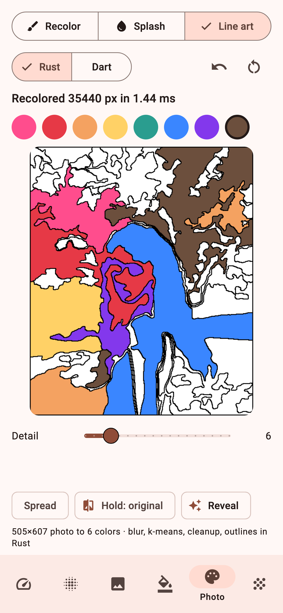
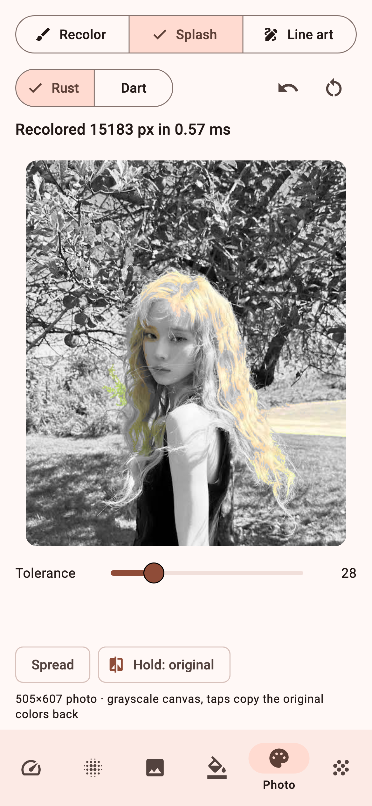
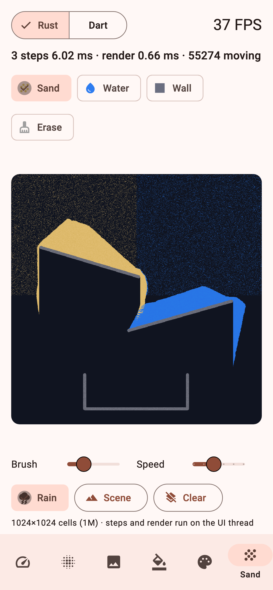
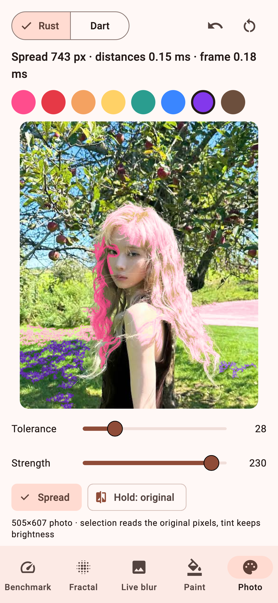
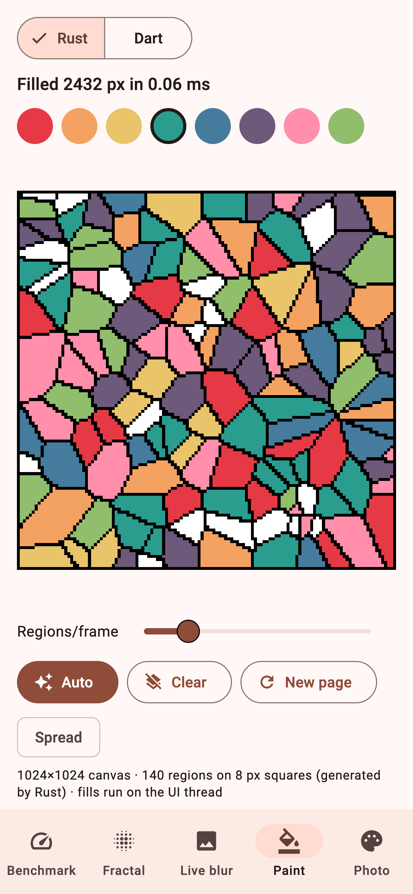
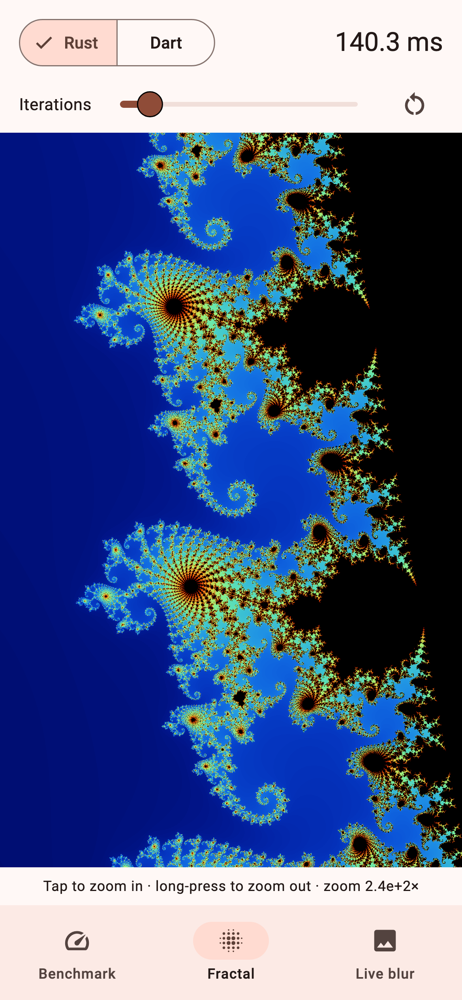
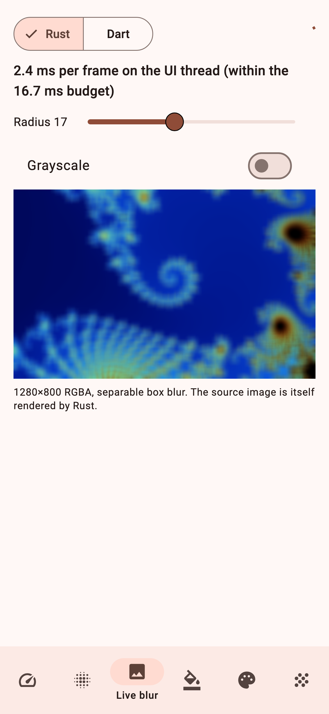
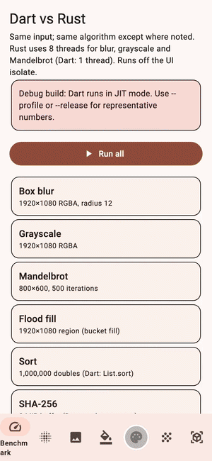
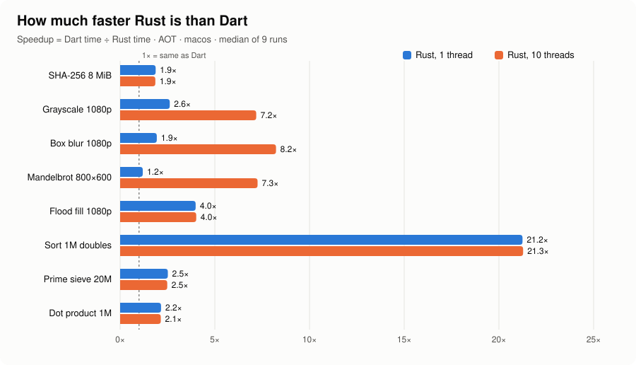
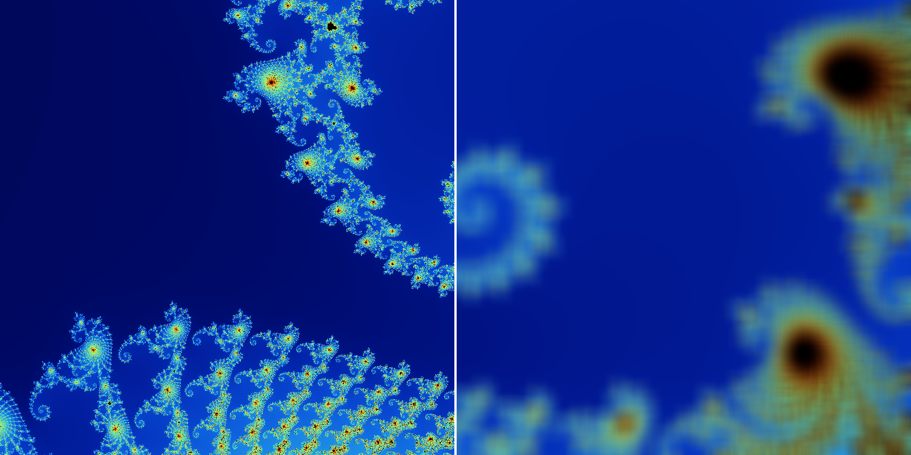

<div align="center">


# flutter_rust: Flutter + Rust FFI for high-performance Flutter apps

**Call Rust from Flutter/Dart with `dart:ffi`: no codegen, zero-copy, built automatically by native assets.**
**Photo recoloring**, **photo to coloring page**, a **spreading fill**, **pixel-art flood fill**,
**falling sand**, image processing, hashing and sorting run **1.5× to 21× faster** than pure Dart. Every number is benchmarked and every result is verified by tests.

[](https://pub.dev/packages/fast_rust)


[](LICENSE)

[Demo video](#demo-video) ·
[Quick start](#4-quick-start) ·
[Benchmarks](#1-benchmark-results) ·
[API](#6-api) ·
[Demo app](#9-demo-app) ·
[FAQ](#14-faq)

</div>

---

**flutter_rust** is a complete, working answer to *"how do I use Rust in Flutter
to speed up my app?"*. It contains:

- **`fast_rust`**: a Dart/Flutter library whose heavy lifting is written in
  Rust and called directly through `dart:ffi` `@Native` functions.
- **`fast_rust_demo`**: a Flutter app that runs Dart and Rust side by side on
  the same input, so you can see the difference on your own phone.

It is a good fit for CPU-heavy work in Flutter apps:
- **photo editing** (recolor hair, sky or clothes while keeping texture);
- **image processing** (blur, grayscale, filters);
- **coloring and pixel-art apps** (flood fill, paint bucket, a fill that spreads from the finger);
- **hashing and crypto** (SHA-256);
- **sorting large datasets**;
- **scientific computing**;
- **graphics rendering** (fractals);
- **signal processing**.

These are jobs where pure Dart, even with `compute()` or isolates, is not fast
enough.

### Highlights

- ⚡ **Fast calls:** one FFI call costs about **1.5 ns**. Rust reads and writes
  Dart's `Uint8List`/`Float64List` in place. Unlike *platform channels*, nothing
  is copied or serialized.
- 🔧 **No native setup:** a build hook (*native assets*) runs `cargo`
  automatically on `flutter run`, `flutter build` and `flutter test`. You don't
  edit Gradle, CMake or Podspecs, and you don't copy `.so` or `.dylib` files by
  hand.
- 🖌️ **Recolor real photos:** tap the hair and it turns pink, with every
  strand still visible. A magic-wand selection over the original pixels plus a
  brightness-preserving tint; a tap on a 505×607 photo takes 0.05 to 1.3 ms.
- 🖍️ **Photo to coloring page:** any photo becomes black outlines on white,
  with closed regions ready to fill (blur, k-means, cleanup, outlines). It
  takes about 116 ms in Rust and 730 ms in Dart for 1920×1080. **Color splash** comes
  for free: gray the photo, then restore regions with `strength: 0`.
- ⏳ **Falling sand:** a million cells of sand, water and walls are stepped
  every frame by a deterministic cellular automaton.
- 🌊 **Spreading fill:** the color flows out from the finger as a round wave
  that follows the region's shape (geodesic distances, Dijkstra with a bucket
  queue).
- 🎨 **Smooth pixel-art coloring:** flood-filling a solid 2-megapixel region
  takes about 3 ms (Dart: 12 ms). A region of a few thousand pixels takes about
  0.1 ms, which is fast enough to paint continuously as your finger drags.
- 🧵 **Real multi-threading:** Rust spreads work over every CPU core with a
  load-balancing work queue. On an Apple M4, Mandelbrot runs **7.3×** faster.
- 📱 **No UI jank:** the `...Async` functions run on a background isolate
  with *non-leaf* calls, so they block neither the UI thread nor the GC.
- ✅ **Verified:** 72 tests across Rust, Dart and Flutter.
  - Rust output matches the pure-Dart implementation bit for bit.
  - SHA-256 output matches `package:crypto`.
- 📦 **Small:** the Rust crate has zero dependencies, builds offline and is easy to audit.

<div align="center">

| Photo to coloring page | Color splash | Falling sand (1M cells) |
|:---:|:---:|:---:|
|  |  |  |
| Rust turns the photo into outlines; tap regions to fill; *Reveal* uses the photo's own colors | Gray canvas; each tap copies the original colors of one region back | Pour sand and water, draw walls, add rain; switch to Dart and watch the FPS |

| Photo recoloring in Rust | Pixel-art coloring in Rust | Fractal explorer in Rust | Real-time blur on the UI thread |
|:---:|:---:|:---:|:---:|
|  |  |  |  |
| Tap or drag with **Spread** on: the color flows along the hair; selection reads the original pixels | Tap or drag to fill; a ~2,400 px region took **0.07 ms** (single sample, test environment) | Renders in the background on 10 Rust threads; the UI stays smooth while zooming | A 1280×800 box blur takes **7.2 ms/frame**, within the 60 fps budget |

</div>

### Demo video

<p align="center">
  
</p>

52 seconds of real app footage:
1. Photo recoloring with the spreading fill.
2. Color splash.
3. The photo turned into a coloring page, filled region by region, then
   *Reveal*.
4. Falling sand, switched between Rust and Dart.
5. The pixel-art coloring book: spread, drag, and Auto mode.
6. A fractal zoom. It is recorded
headless by `examples/fast_rust_demo/tool/video_test.dart`. Full quality:
[`docs/video/demo.mp4`](docs/video/demo.mp4).

*These are real screenshots of the app, rendered headless with `flutter test`;
see [section 15](#15-regenerating-the-readme-images-and-numbers). The
millisecond values were measured in a desktop test environment, not on a
phone.*

---

## Table of contents

1. [Benchmark results](#1-benchmark-results)
2. [Repository layout](#2-repository-layout)
3. [Requirements](#3-requirements)
4. [Quick start](#4-quick-start)
5. [Using the library in your app](#5-using-the-library-in-your-app)
6. [API](#6-api)
7. [Sync or async: the leaf-call rule](#7-sync-or-async-the-leaf-call-rule)
8. [Architecture](#8-architecture)
9. [Demo app](#9-demo-app)
10. [Tests and benchmarks](#10-tests-and-benchmarks)
11. [Adding a new Rust function](#11-adding-a-new-rust-function)
12. [Troubleshooting](#12-troubleshooting)
13. [Verification status and limitations](#13-verification-status-and-limitations)
14. [FAQ](#14-faq)
15. [Regenerating the README images and numbers](#15-regenerating-the-readme-images-and-numbers)

---

## 1. Benchmark results

<picture>
  <source media="(prefers-color-scheme: dark)" srcset="docs/images/benchmark-dark.svg">
  
</picture>

Machine: Apple M4 (10 threads), macOS. Built AOT (`dart build cli`, equivalent
to a release build); each value is the median of 9 runs after warm-up. Raw data
is in [`docs/benchmark.json`](docs/benchmark.json).

- **Rust 1T**: Rust limited to one thread (single-core speed).
- **Rust 10T**: Rust using all threads.
- Dart always runs on a single thread.

| Task                                       | Dart ms | Rust 1T |     × | Rust 10T |     × |
|--------------------------------------------|--------:|--------:|------:|---------:|------:|
| SHA-256 of 8 MiB (Dart: `package:crypto`)  |   34.83 |   18.56 |  1.9× |    18.73 |  1.9× |
| Grayscale 1920×1080                        |    2.31 |    0.88 |  2.6× |     0.32 |  7.2× |
| Box blur 1920×1080, r=12                   |   21.80 |   11.26 |  1.9× |     2.65 |  8.2× |
| Mandelbrot 800×600, 500 iterations         |  127.06 |  106.28 |  1.2× |    17.51 |  7.3× |
| Flood fill of a 1920×1080 region           |   11.69 |    2.93 |  4.0× |     2.91 |  4.0× |
| Sort 1M `double`s (Dart: `List.sort`)      |  257.32 |   12.11 | 21.2× |    12.09 | 21.3× |
| Count primes ≤ 20 million                  |   23.24 |    9.23 |  2.5× |     9.34 |  2.5× |
| Dot product of 1M `double`s                |    0.69 |    0.32 |  2.2× |     0.32 |  2.1× |

**Newer pixel kernels.** These two were measured later on a different machine
(Apple M1 Pro, 8 threads, under background load), so compare them only with
each other. Both run on a solid 1920×1080 region, which selects the whole frame:

| Task                                                   | Dart ms | Rust ms |    × |
|--------------------------------------------------------|--------:|--------:|-----:|
| Photo recolor (`recolorRegionRgba`)                    |   52.90 |   27.04 | 2.0× |
| Spreading-fill distances (`spreadDistancesRgba`)       |  182.74 |   54.30 | 3.4× |
| Photo to coloring page 1920×1080, demo settings (`photoToColoringPage`) | 731.88 | 115.62 | 6.3× |
| Falling-sand step 1024×1024, random grid (`sandStep`)  |   13.75 |    8.96 | 1.5× |

The sand step is a sequential, branchy scan that AOT Dart handles well, so
Rust gains only 1.5× there. A tapped region in a real photo is usually far
smaller than the whole frame. In the demo, one tap on
505×607 px takes 0.05 to 1.3 ms.

One FFI call (leaf call, AOT) costs about **1.5 ns**. Results vary by about
±15% between runs; for example, the 10-thread blur has measured anywhere from
2.6 to 4.8 ms.

**How to read these numbers:**

- **Flood fill** is sequential and cannot be split across threads, so its 4×
  comes entirely from single-core speed. Rust compares whole 4-byte pixels and
  fills each span with a vectorized store loop. The benchmark fills a solid
  rectangle, which is the easiest case for a scanline fill; irregular regions
  cost more per pixel.
- **Same algorithm on both sides**, with two exceptions:
  - **SHA-256:** the Dart side is `package:crypto`.
  - **Sort:** the Dart side is `List.sort`, which calls a comparator closure
    for every comparison; the Rust side is pdqsort. Most of the 21× comes from
    Dart's comparator overhead.
- **Mandelbrot:** for a simple floating-point loop like this one, AOT Dart is
  about **as fast** as Rust on one core (1.2×). The 7.3× comes entirely from
  multi-threading.
- **Phones will differ:** these numbers come from one desktop machine. Run the
  demo app with `--profile` or `--release` on a real device to get your own.
- **When not to use FFI:** when each call does only a few nanoseconds of work.
  The win comes from moving *whole loops* into Rust, not individual operations.

<p align="center">
  
  <br/><sub>Before and after <code>FastRust.boxBlurRgba</code> (radius 18). The source image is also rendered by <code>FastRust.mandelbrotRgba</code>.</sub>
</p>

## 2. Repository layout

```
flutter_rust/
├── packages/fast_rust/              # The library (pure Dart package, works in Flutter too)
│   ├── rust/                        # Rust crate (cdylib, zero dependencies)
│   │   ├── Cargo.toml               # Release profile: LTO, opt-level 3, panic=abort
│   │   └── src/
│   │       ├── lib.rs               # C ABI: the fr_* functions exported to Dart
│   │       ├── parallel.rs          # Row-band splitting, work queue, thread limit
│   │       ├── hash.rs              # SHA-256 (FIPS 180-4)
│   │       ├── image.rs             # Grayscale, separable box blur
│   │       ├── fractal.rs           # Mandelbrot
│   │       ├── coloring.rs          # Coloring pages, flood fill, photo recolor, spreading fill
│   │       ├── lineart.rs           # Photo to coloring page: blur, k-means, cleanup, outlines
│   │       ├── sand.rs              # Falling-sand cellular automaton
│   │       └── numeric.rs           # f64 sort, prime sieve, dot product
│   ├── hook/build.dart              # Build hook: runs cargo for the right target, registers the CodeAsset
│   ├── lib/
│   │   ├── fast_rust.dart           # Public entry point
│   │   └── src/
│   │       ├── bindings.dart        # @Native declarations (leaf and non-leaf)
│   │       ├── api.dart             # Safe API: class FastRust
│   │       └── dart_reference.dart  # Same algorithms in pure Dart (oracle and baseline)
│   ├── test/fast_rust_test.dart     # 40 tests: correctness, validation, async, coloring, recolor, sand
│   ├── example/fast_rust_example.dart # Command-line tour: every kernel in Rust and Dart, outputs compared
│   ├── benchmark/benchmark.dart     # Command-line benchmark (--json exports results)
│   └── tool/readme_images.dart      # Generates the README charts and images from real output
└── examples/fast_rust_demo/         # Flutter demo app
    ├── lib/
    │   ├── main.dart                # 6 tabs, each built on first visit
    │   ├── benchmarks.dart          # Benchmark cases run on a background isolate
    │   ├── engine.dart              # Rust/Dart enum, RGBA to ui.Image
    │   ├── spread.dart              # One running spreading-fill animation
    │   └── pages/                   # benchmark, fractal, blur, paint, photo and sand pages
    ├── test/app_test.dart           # Widget tests (load the real Rust library through native assets)
    ├── assets/photo.jpg             # Photo used by the Photo tab
    └── tool/                        # screenshots_test.dart, video_test.dart, make_video.sh
docs/
├── benchmark.json                   # Raw results behind the table and charts
├── images/                          # Banner, charts, app screenshots, Rust-rendered images
└── video/                           # demo.mp4 and demo.gif, recorded from the real app
```

## 3. Requirements

| Component | Version | Notes |
|---|---|---|
| Dart | ≥ 3.10 | Needs build hooks / native assets. Tested with Dart 3.13.4. |
| Flutter | with build-hook support | Tested with Flutter 3.47.5. |
| Rust | ≥ 1.88 | Install via [rustup](https://rustup.rs). Tested with 1.99.1. |

Add the Rust targets for the platforms you build for:

```sh
# Android
rustup target add aarch64-linux-android armv7-linux-androideabi x86_64-linux-android i686-linux-android
# iOS (devices + simulator)
rustup target add aarch64-apple-ios aarch64-apple-ios-sim x86_64-apple-ios
# macOS
rustup target add aarch64-apple-darwin x86_64-apple-darwin
# Linux / Windows
rustup target add x86_64-unknown-linux-gnu aarch64-unknown-linux-gnu
rustup target add x86_64-pc-windows-msvc aarch64-pc-windows-msvc
```

- **Android:** requires the Android NDK. Flutter passes the NDK's clang path to
  the build hook, which uses it as the linker.
- **iOS/macOS:** require Xcode.
- **`cargo` on `PATH`:** `cargo` must be on `PATH`. If it isn't, the hook falls
  back to `~/.cargo/bin/cargo`, because IDEs launched from the GUI often lack
  that path.

## 4. Quick start

```sh
git clone <repo> flutter_rust && cd flutter_rust

# 1. Test the library (the first run builds Rust, which takes a few seconds)
cd packages/fast_rust
dart pub get
dart test

# 2. Benchmark
dart run benchmark/benchmark.dart                # JIT (like debug builds)
dart build cli -t benchmark/benchmark.dart       # AOT (like release builds)
./build/cli/*/bundle/bin/benchmark

# 3. Run the demo app
cd ../../examples/fast_rust_demo
flutter pub get
flutter test
flutter run --release        # or --profile; debug builds run Dart in JIT mode and are slower
```

## 5. Using the library in your app

Add the dependency from [pub.dev](https://pub.dev/packages/fast_rust):

```sh
flutter pub add fast_rust
```

You also need Rust ≥ 1.88 and the Rust targets for your platforms (see
[section 3](#3-requirements)); the build hook compiles the crate on your
machine.

Examples:

```dart
import 'dart:typed_data';
import 'package:fast_rust/fast_rust.dart';

// Hashing: zero-copy, synchronous
final Uint8List digest = FastRust.sha256(bytes);

// A small blur inside a frame: edits the RGBA buffer in place
FastRust.boxBlurRgba(pixels, width: w, height: h, radius: 10);

// Heavy work: runs on a background isolate, blocks neither the UI nor the GC
final Uint8List blurred =
    await FastRust.boxBlurRgbaAsync(bigImage, width: W, height: H, radius: 30);

final Uint8List fractal = await FastRust.mandelbrotRgbaAsync(
  width: 800,
  height: 600,
  scale: 3 / 800,          // size of one pixel in the complex plane
  maxIterations: 500,
);

// Pixel-art coloring: generate a page, then "pour paint" into the tapped region
final page = FastRust.coloringPageRgba(width: 1024, height: 1024, cells: 140, block: 8);
final painted = FastRust.floodFillRgba(page,
    width: 1024, height: 1024, x: tapX, y: tapY, color: 0x2A9D8FFF);

// Photo recoloring: select by color around the tap and tint, keeping texture.
// `source` is the decoded photo (never modified), `canvas` a copy you display.
FastRust.recolorRegionRgba(source, canvas,
    width: w, height: h, x: tapX, y: tapY, color: 0xFF4D8DFF, tolerance: 28);

// Spreading fill: distances once, then one ring per frame.
final dist = Uint32List(w * h);
final maxDist = FastRust.spreadDistancesRgba(source, dist,
    width: w, height: h, x: tapX, y: tapY, tolerance: 28);
FastRust.paintByDistanceRgba(source, canvas, dist,
    width: w, height: h, from: previousRadius, to: radius,
    color: 0xFF4D8DFF, tint: true);   // tint: false paints a flat color

// In-place sort (IEEE-754 total order)
FastRust.sortFloat64(values);
final sorted = await FastRust.sortFloat64Async(hugeList);   // returns a sorted copy

// Showing an RGBA buffer in Flutter
ui.decodeImageFromPixels(fractal, 800, 600, ui.PixelFormat.rgba8888, (img) {
  // use with RawImage(image: img)
});
```

Native errors are thrown as `FastRustException` (null pointer, invalid argument,
out of memory). Invalid Dart arguments throw `ArgumentError` or `RangeError`
before anything is sent to Rust.

## 6. API

Everything lives in `abstract final class FastRust`.

| Function | Call kind | Description |
|---|---|---|
| `sha256(Uint8List) → Uint8List` | sync, leaf, zero-copy | 32-byte SHA-256 digest. |
| `sha256Async(Uint8List) → Future<Uint8List>` | background isolate, non-leaf | Same as above, without blocking the UI or GC. |
| `grayscaleRgba(Uint8List)` | sync, leaf, in place | BT.601 grayscale; alpha is kept. |
| `boxBlurRgba(rgba, width:, height:, radius:)` | sync, leaf, in place, multi-threaded | Separable box blur, O(pixels) for any radius. |
| `boxBlurRgbaAsync(...) → Future<Uint8List>` | background isolate, non-leaf | Returns a new image; the input is untouched. |
| `mandelbrotRgba(width:, height:, centerX:, centerY:, scale:, maxIterations:) → Uint8List` | sync, non-leaf, multi-threaded | Renders RGBA8888. |
| `mandelbrotRgbaAsync(...) → Future<Uint8List>` | background isolate, non-leaf | Same as above, in the background. |
| `sortFloat64(Float64List)` | sync, leaf, in place | pdqsort with `f64::total_cmp`. |
| `sortFloat64Async(Float64List) → Future<Float64List>` | background isolate, non-leaf | Returns a sorted copy. |
| `coloringPageRgba(width:, height:, cells:, block:, seed:) → Uint8List` | sync, non-leaf, multi-threaded | Generates a pixel-art coloring page: `cells` Voronoi regions on a grid of `block`×`block` px squares, with black outlines. The same `seed` gives the same page. |
| `coloringPageRgbaAsync(...) → Future<Uint8List>` | background isolate, non-leaf | Same as above, in the background. |
| `floodFillRgba(rgba, width:, height:, x:, y:, color:, tolerance:) → int` | sync, leaf, in place | Paint bucket: fills the 4-connected region around (x, y) with `color` (`0xRRGGBBAA`), with a per-channel `tolerance` of 0–255. Returns the number of pixels painted (0 when `tolerance` is 0 and the region already has that color). |
| `recolorRegionRgba(source, target, width:, height:, x:, y:, color:, tolerance:, strength:) → int` | sync, leaf, zero-copy | Photo recoloring. Selects the 4-connected region of `source` whose RGB is within `tolerance` of the tapped pixel, then writes a luminance-preserving tint of those pixels into `target`; `strength` (0–255) blends from the original color to the full tint. `source` is only read. Returns the number of written pixels. |
| `spreadDistancesRgba(source, distances, width:, height:, x:, y:, tolerance:) → int` | sync, leaf, zero-copy | Spreading fill, step 1: writes each region pixel's geodesic distance from the tap into a `Uint32List` (`spreadStep` = 5 units per orthogonal pixel, 7 per diagonal), and `unreached` outside the region. Returns the largest distance. |
| `paintByDistanceRgba(source, target, distances, width:, height:, from:, to:, color:, strength:, tint:) → int` | sync, leaf, multi-threaded | Spreading fill, step 2: paints the pixels with `from ≤ distance < to`, as a flat color or (`tint: true`) a tint of `source`. Consecutive frames never paint a pixel twice. |
| `photoToColoringPage(rgba, width:, height:, colors:, smooth:, minRegion:, lineWidth:) → ColoringPage` | sync, non-leaf, multi-threaded | Photo to coloring page: box blur, k-means into `colors` clusters, two 3×3 majority filters, merge of regions under `minRegion` px, outlines `lineWidth` px wide plus a frame. Returns `rgba` (black on white), `labels` (cluster per pixel, `lineLabel` on outlines) and `palette` (the photo's colors). |
| `photoToColoringPageAsync(...) → Future<ColoringPage>` | background isolate | Same, in the background. |
| `sandStep(cells, width:, height:, frame:) → int` | sync, leaf, in place | One falling-sand step on a grid of `SandMaterial` values (empty, wall, sand, water). Deterministic for a given frame. Returns how many particles moved. |
| `sandRenderRgba(cells, rgba, width:, height:)` | sync, leaf, multi-threaded | Draws the grid into RGBA8888. |
| `countPrimes(int) → int` | sync, non-leaf | Number of primes ≤ limit (odd-only sieve). |
| `dot(Float64List, Float64List) → double` | sync, leaf | Dot product with 4 accumulators so LLVM can vectorize. |
| `threadCount` / `setThreadLimit(int)` | | Read or cap the number of Rust threads (`0` = default: one per core, at most 16). |
| `abiVersion`, `add(a, b)` | | ABI version; `add` exists to measure FFI call overhead. |

**Input limits** (exceeding them throws `RangeError`):

| Constant | Value | Why |
|---|---|---|
| `FastRust.maxBlurRadius` | 1024 | Keeps window sums from overflowing `u32` and bounds the running time. |
| `FastRust.maxIterations` | 2²⁰ | Prevents hangs from huge iteration counts. |
| `FastRust.maxColoringCells` / `maxColoringBlock` | 65,536 / 256 | Bounds on coloring-page parameters. |
| `FastRust.maxColoringWork` | 2³¹ | Grid squares × regions (the cost of the nearest-region search). Exceeding it throws `ArgumentError`, which bounds page generation time. |
| `FastRust.maxPrimeLimit` | 2³¹ − 1 | The sieve needs `limit/2` bytes (up to 1 GiB). If the allocation fails, a `FastRustException` is thrown and the app does not abort. |

**NaN order when sorting:** `-NaN < -∞ < … < -0.0 < 0.0 < … < ∞ < NaN`. This
differs from Dart's `List.sort`, which puts every NaN last.

`DartReference` provides the same functions in pure Dart. They are used by the
tests and as the benchmark baseline.

## 7. Sync or async: the leaf-call rule

This is the most important thing to understand about high-performance FFI.

**Leaf calls** (`@Native(isLeaf: true)`):
- They are the cheapest kind of call, because the thread never leaves the Dart VM.
- They are the only kind that may receive `typedList.address`, a pointer
  straight into the Dart heap with no copy.
- The trade-off: **while a leaf call runs, GC is paused for every isolate in
  the group**, including the UI isolate, even if you call it from
  `Isolate.run`.

**Non-leaf calls:**
- The thread leaves the VM, so other isolates keep collecting garbage.
- They cannot take pointers into the Dart heap, so they must use native memory
  (`malloc`).

How the library uses them:

| Case | Call kind |
|---|---|
| Sync functions on your buffers (`sha256`, `boxBlurRgba`, `grayscaleRgba`, `floodFillRgba`, `recolorRegionRgba`, `spreadDistancesRgba`, `paintByDistanceRgba`, `sortFloat64`, `dot`) | **Leaf**, zero-copy. Use them only for work of a few milliseconds, such as the per-frame blur in the demo. |
| `...Async` | Background isolate: copy into native memory, make a **non-leaf** call, copy the result back. Use them for long work. |
| `mandelbrotRgba`, `coloringPageRgba`, `countPrimes` | Always **non-leaf**, because they only write output or take no buffer. |

Rule of thumb: if a call can take more than about 4 ms on a phone (a quarter of
a 16.7 ms frame), use the `Async` version.

## 8. Architecture

```
 Dart / Flutter app
        │  FastRust.boxBlurRgba(pixels, …)
        ▼
 lib/src/api.dart          validates arguments, picks leaf or non-leaf
        │
 lib/src/bindings.dart     @Native<…>(symbol: 'fr_box_blur_rgba', isLeaf: true)
        │                  asset id = package:fast_rust/src/bindings.dart
        ▼
 libfast_rust.{so,dylib,dll}   ← built and bundled by hook/build.dart
        │
 rust/src/lib.rs           extern "C" fr_*: checks nulls and sizes, returns an i32 status
        ▼
 rust/src/image.rs …       pure Rust kernels, parallelized via parallel.rs
```

**Build hook (`hook/build.dart`):**

1. The Dart or Flutter SDK runs the hook with the current target OS and architecture.
2. The hook maps it to a Rust target triple: for example, `android/arm64`
   becomes `aarch64-linux-android`, and `iOS simulator/arm64` becomes
   `aarch64-apple-ios-sim`.
3. The hook runs `cargo rustc --release --lib --crate-type cdylib --target
   <triple>`. Output goes into the hook's cache directory (`.dart_tool/…`), so
   later builds are incremental.
   - On Android, the hook links with the NDK's clang wrapper
     (`<triple><api>-clang`) and adds `-z max-page-size=16384` to support
     devices with 16 KB pages (Android 15+).
   - On Apple platforms, it sets `MACOSX_DEPLOYMENT_TARGET` or
     `IPHONEOS_DEPLOYMENT_TARGET` from Flutter's configuration.
4. The hook registers `CodeAsset(name: 'src/bindings.dart',
   linkMode: DynamicLoadingBundled())`. The SDK bundles the library into the
   app (APK, framework, bundle). The `@Native` functions in `bindings.dart`
   resolve their symbols automatically, with no `DynamicLibrary.open`.
5. The hook declares every file in `rust/src/` as a dependency, so editing Rust
   code triggers a rebuild.

**C ABI conventions (`rust/src/lib.rs`):**
- Every `fr_*` function takes a pointer plus a length and never allocates
  memory that crosses the FFI boundary. The caller owns the memory.
- Functions return an `i32`: `0` means OK, `-1` a null pointer, `-2` an invalid
  argument. The Dart side turns these codes into `FastRustException`s.
- With `len == 0`, the pointer is never dereferenced.
- With `panic = "abort"` and all inputs validated up front, no unwinding can
  cross the FFI boundary.

**Multi-threading (`rust/src/parallel.rs`):**
- Data is split into bands of rows, about 16K elements each.
- The bands sit in a shared, mutex-protected queue, so threads that finish
  early pick up more work. This matters for uneven loads like fractals: moving
  from a fixed split to the queue took Mandelbrot from 3.6× to 6.8× (measured
  under JIT).
- The calling thread works too, and small inputs run on it directly to avoid
  spawn overhead.
- Kernels have two ways to adjust band sizes:
  - Kernels with per-band setup cost, such as the blur's vertical window, ask
    for taller bands via `min_band_rows`.
  - Kernels that are expensive per element, such as the coloring page's region
    search, set an explicit band height via `for_each_band_of`.

**O(pixels) box blur:** the blur makes two passes, horizontal then vertical.
Each pass keeps a running sum, and samples clamped at the image edge are
counted by multiplication instead of looping, so the cost does not depend on
the radius.

## 9. Demo app

`examples/fast_rust_demo` has 6 tabs. Each tab is built on first visit, so no
heavy work runs at startup.

| Tab | What it shows |
|---|---|
| **Benchmark** | Tap *Run all*: each case runs in Dart and in Rust on a background isolate, then the tab shows comparison bars and the speedup. Debug builds show a warning. |
| **Fractal** | Explore the Mandelbrot set at screen resolution (up to 1200 px). Tap to zoom in, long-press to zoom out, adjust the iteration count, and switch between the Rust and Dart engines to compare render times. Rendering runs on a background isolate with a non-leaf call, so the UI stays smooth. |
| **Paint** (coloring) | A 1024×1024 pixel-art coloring book generated by Rust. The page does not scroll, so every drag paints. Pick a color, then **tap or drag your finger** to fill regions with the flood fill; the app shows the pixel count and time of each fill. **Spread** makes each tap flow out as a wave (flat color, `paintByDistanceRgba`). **Auto** refills *N* random regions every frame (slider: 1–200) and shows **FPS** plus the fill time per frame. Switch Rust/Dart to compare on your own device. FPS also depends on image upload time, not just fill time. |
| **Photo** (Recolor / Splash / Line art) | **Splash** turns the photo gray and each tap restores one region's colors (`recolorRegionRgba` with `strength: 0`). **Line art** turns the photo into a coloring page with `photoToColoringPage` (the *Detail* slider sets the number of colors); taps fill regions with a flat color, and **Reveal** paints every region in the photo's own colors. **Recolor**, described next, is the default mode. A real 505×607 photo, decoded once into RGBA bytes. Pick a color and **tap or drag** on the hair, the grass or the road: `recolorRegionRgba` selects similar connected pixels and tints them while keeping their brightness. With **Spread** on (the default), the color flows out from the finger frame by frame instead, and every drag step starts a new flow, like a brush. *Tolerance* and *Strength* sliders, **Undo** (20 steps), **Reset**, and **Hold: original** to compare. The caption shows the distance pass and per-frame paint times. |
| **Sand** | A 1024×1024 falling-sand world (about a million cells). Drag to pour sand or water, draw walls, or erase. **Rain** adds two streams, **Speed** sets steps per frame (1–6), and **Scene** restores the starting ramps and cup. The caption shows step and render times. Switch to Dart to watch the FPS drop. |
| **Live blur** | A 1280×800 image (itself rendered by Rust) is blurred on the UI thread on every slider move. The screen shows the time per frame against the 16.7 ms budget. If the progress spinner freezes, the UI thread is blocked. |

Run it:

```sh
cd examples/fast_rust_demo
flutter run --profile      # representative numbers; use --release for the real experience
```

## 10. Tests and benchmarks

| Command | What it checks |
|---|---|
| `cd packages/fast_rust/rust && cargo test --release` | **23 Rust tests:**<br>• a photo with two halves becomes two framed regions with an outline between them, tiny speckles merge away, and the output is deterministic<br>• sand falls and piles up, water levels out, sand sinks through water, displaced water moves only once per step, and walls hold<br>• flood fill matches BFS on random coloring pages, including tolerance<br>• the spreading fill covers exactly the 4-connected region, spreads as a round wave and paints each pixel once<br>• the tint keeps black, white and alpha, and recolor never writes outside the region<br>• SHA-256 NIST vectors<br>• blur matches a naive O(r²) version, even with a radius larger than the image<br>• parallel output matches serial<br>• NaN ordering<br>• prime sieve<br>• the FFI rejects nulls and bad sizes |
| `cd packages/fast_rust && dart test` | **40 tests:**<br>• photo to coloring page matches the Dart reference (page, labels, palette) for four settings, is black and white with a frame, and can be filled<br>• 60 falling-sand steps match the Dart reference cell for cell on four grid sizes, material is conserved, and sand comes to rest<br>• coloring pages (including negative seeds and seeds ≥ 2⁶³) and flood fills match the Dart reference pixel for pixel, including on unaligned buffers<br>• photo recolor and spreading-fill distances and rings match the Dart reference pixel for pixel on a fractal "photo" at several tolerances<br>• Rust matches `package:crypto` and `DartReference` bit for bit<br>• views with offsets<br>• input validation<br>• the async non-leaf variants<br>• NaN order<br>• thread limits do not change results |
| `cd examples/fast_rust_demo && flutter test` | **9 tests:**<br>• Photo splash and line-art modes: a tap restores or fills a region, and Reveal is undoable<br>• the Sand tab simulates, pours on drag without scrolling, and runs with both engines<br>• the Paint tab fills on a vertical drag (without scrolling), with Spread, and in Auto mode<br>• the Photo tab spreads a fill over several frames, recolors on drag without scrolling, and undoes each stroke<br>• Rust loads inside `flutter test`<br>• pages build lazily<br>• the fractal renders through an isolate<br>• live blur renders a frame<br>• a benchmark case runs |
| `dart run benchmark/benchmark.dart` | Table comparing Dart, Rust 1T and Rust nT. |

Lints: `cargo clippy --release --all-targets`, `dart analyze`, `flutter analyze`.
App screenshots are not part of the normal test suite; generate them separately
with `flutter test tool/screenshots_test.dart --update-goldens`.

## 11. Adding a new Rust function

1. **Rust:** write the kernel in a module, then export it from `rust/src/lib.rs`:

   ```rust
   #[no_mangle]
   pub unsafe extern "C" fn fr_invert_rgba(rgba: *mut u8, len: usize) -> i32 {
       if len % 4 != 0 { return Status::InvalidArgument as i32; }
       let rgba = try_slice!(slice_mut(rgba, len));
       for px in rgba.chunks_exact_mut(4) { px[0] = !px[0]; px[1] = !px[1]; px[2] = !px[2]; }
       Status::Ok as i32
   }
   ```

2. **Binding:** declare it in `lib/src/bindings.dart`.
   - Use a leaf call for short work on Dart buffers.
   - Use a non-leaf call (drop `isLeaf`) with native memory for long work.

   ```dart
   @Native<Int32 Function(Pointer<Uint8>, Size)>(symbol: 'fr_invert_rgba', isLeaf: true)
   external int frInvertRgba(Pointer<Uint8> rgba, int len);
   ```

3. **API:** wrap it in `FastRust` (`lib/src/api.dart`), validate the arguments,
   then call `_check(...)`.
4. **Test:** add a Dart version to `DartReference` and a test in
   `test/fast_rust_test.dart` that compares the two.
5. If you change the signature of an existing function, bump `fr_abi_version`.

No build-hook changes are needed: every file in `rust/src/` is already tracked.

## 12. Troubleshooting

| Symptom | Fix |
|---|---|
| `cargo rustc --target … failed`, suggesting `rustup target add …` | The Rust target for that platform is missing. Run the suggested command. |
| `cargo` not found when building from an IDE | Add `~/.cargo/bin` to the IDE's `PATH`. The hook also tries that path itself. |
| Android: linker error, `…-clang` does not exist | The installed NDK has no wrapper for the requested API level. Upgrade the NDK or adjust `minSdk`. |
| `Invalid argument(s): Illegal argument in isolate message: object is unsendable` | The closure sent to `Isolate.run` was created inside a `State` method and captured `this`. Create the closure in a top-level function, like `_renderInBackground` in `fractal_page.dart`. |
| In-app benchmark numbers look unusually low | You are running a debug (JIT) build. Use `--profile` or `--release`. |
| UI janks on large inputs | You are calling a sync (leaf) function for long work. Switch to the `...Async` version; see [section 7](#7-sync-or-async-the-leaf-call-rule). |

## 13. Verification status and limitations

**Verified** on macOS arm64:
- `cargo test` and clippy.
- `dart test` and `dart analyze`.
- `flutter test` and `flutter analyze`. In all three test environments, the
  Rust library is built and loaded through native assets.
- JIT and AOT benchmarks.

**Not yet verified:** app builds for Android, iOS and desktop. The logic for
target triples, the NDK linker and deployment targets is written and reviewed,
but has not been run on those platforms.

**Known limitations:**
- Each parallel call spawns fresh threads; there is no persistent thread pool
  yet. That costs a few tens of µs per call, which may matter for per-frame
  blur on Android.
- Several isolates calling parallel functions at once can oversubscribe the CPU cores.
- Sync leaf functions still pause GC while they run (see section 7).
- Photo selection compares each pixel with the tapped one, so regions whose
  color is close to a neighbor's (blonde hair next to skin) can leak. Lower the
  tolerance or tap several times.

## 14. FAQ

<details open>
<summary><b>How do I call Rust code from Flutter?</b></summary>

1. Compile Rust into a dynamic library (`cdylib`) that exports `extern "C"`
   functions.
2. Declare those functions in Dart with `dart:ffi`'s `@Native`.
3. Use a build hook (native assets) so Flutter builds and bundles the library
   for each platform automatically.

This project does all three for you. See [section 8](#8-architecture) and
[section 11](#11-adding-a-new-rust-function).
</details>

<details>
<summary><b>Do I need <code>flutter_rust_bridge</code>?</b></summary>

No. `flutter_rust_bridge` shines when you need to pass rich types (structs,
enums, `String`s, streams, async Rust) and want bindings generated for you.
This project takes a minimal hand-written approach, which fits functions that
work on numeric buffers (images, `double` arrays, bytes):

- there is no codegen step;
- there are no Rust dependencies;
- pointers go straight into Dart buffers, so call overhead is close to zero.
</details>

<details>
<summary><b>How is FFI different from platform channels (MethodChannel)?</b></summary>

Platform channels send asynchronous messages through Kotlin/Swift and must
serialize the data, so each call costs microseconds to milliseconds. FFI calls
native functions directly and synchronously, at about 1.5 ns per call. For large
data such as images, FFI also avoids copying.
</details>

<details>
<summary><b>Is Rust always faster than Dart?</b></summary>

No. AOT Dart is already quite fast for simple arithmetic loops: on one core,
Rust is only 1.2× faster for Mandelbrot. Rust wins clearly when:

- the work can use multiple threads;
- the algorithm benefits from LLVM optimizations (sorting, SHA-256);
- it avoids Dart overhead (comparator closures, bounds checks).

Measure before you port code.
</details>

<details>
<summary><b>Will calling Rust make my Flutter UI jank?</b></summary>

It can, if you call a sync function for long work. Sync functions are *leaf
calls*: they block the calling isolate and pause GC for the whole isolate group.
For anything longer than a few milliseconds, use the `...Async` functions. They
run on a background isolate with non-leaf calls and block neither the UI nor the
GC. See [section 7](#7-sync-or-async-the-leaf-call-rule).
</details>

<details>
<summary><b>Does it work on Android and iOS?</b></summary>

The build hook handles Android (arm64, armv7, x86_64, x86), iOS (devices and
simulator), macOS, Linux and Windows. So far it has only been **verified on
macOS**; Android and iOS builds have not been tried yet. See
[section 13](#13-verification-status-and-limitations).
</details>

<details>
<summary><b>Can I build a smooth coloring-book or pixel-art app in Flutter?</b></summary>

Yes. `FastRust.floodFillRgba` fills a solid 2-megapixel region in about 3 ms,
versus 12 ms in pure Dart (measured on a desktop). A region of a few thousand
pixels takes about 0.1 ms, which is fast enough to fill inside `onPanUpdate`
while the user drags. See the **Paint** tab in the demo app
(`examples/fast_rust_demo/lib/pages/paint_page.dart`) for a complete example:
color picker, tap, drag, and Auto mode with an FPS counter.
</details>

<details>
<summary><b>Can I use it on camera frames or images from files?</b></summary>

Yes. Every image function takes an **RGBA8888** buffer (a `Uint8List` of length
`width × height × 4`). You can get one from
`ui.Image.toByteData(format: ImageByteFormat.rawRgba)`, or from a camera frame
after converting it to RGBA.
</details>

## 15. Regenerating the README images and numbers

Every image in `docs/images` except the banner is produced by the library
itself, so you can check them yourself:

```sh
cd packages/fast_rust
dart build cli -t benchmark/benchmark.dart
./build/cli/*/bundle/bin/benchmark --json=../../docs/benchmark.json   # measurements
dart run tool/readme_images.dart ../../docs                           # SVG charts, fractal, blur

cd ../../examples/fast_rust_demo
flutter test tool/screenshots_test.dart --update-goldens              # app screenshots
flutter test tool/video_test.dart && tool/make_video.sh               # demo video (needs ffmpeg)
```

| Image | Source |
|---|---|
| `benchmark-light.svg`, `benchmark-dark.svg` | `tool/readme_images.dart`, from `docs/benchmark.json` |
| `mandelbrot.png`, `blur-before-after.png` | `FastRust.mandelbrotRgba` and `FastRust.boxBlurRgba` |
| `screenshot-*.png` (photo, line art, splash, sand, fractal, blur, paint) | Golden tests of the demo app, with real Roboto fonts |
| `docs/video/demo.mp4`, `demo.gif` | `tool/video_test.dart` records frames of the real app; `tool/make_video.sh` encodes them with ffmpeg |
| `banner.png` | AI-generated illustration; contains no data |

---

<div align="center">


**Keywords:** Flutter Rust · Flutter FFI · dart:ffi · call Rust from Flutter ·
Flutter performance optimization · speed up Flutter · native assets · build hooks ·
Flutter image processing · Flutter photo editor · recolor image · magic wand ·
Flutter coloring app · photo to line art · coloring page generator · color splash ·
falling sand · cellular automaton · flood fill · spreading fill · pixel art ·
coloring book · Rust cdylib · flutter_rust_bridge alternative · Dart isolate ·
Flutter performance

If you find this useful, please ⭐ the repo so more people can find it.

Released under the [MIT License](LICENSE).

</div>
