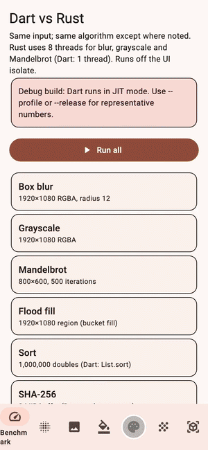
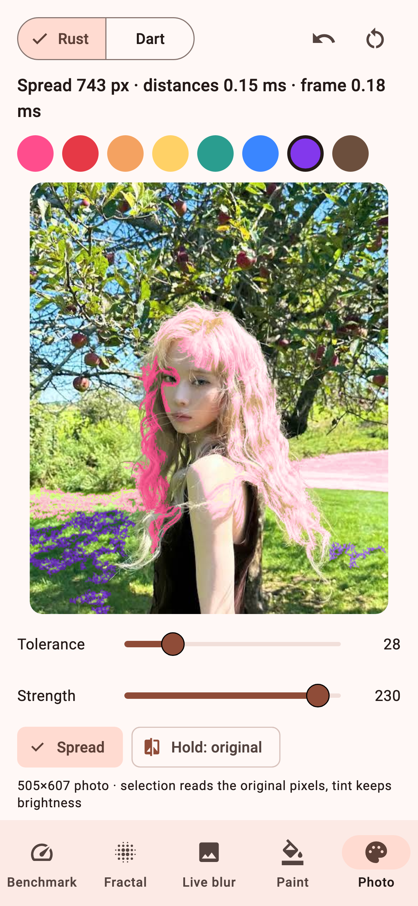
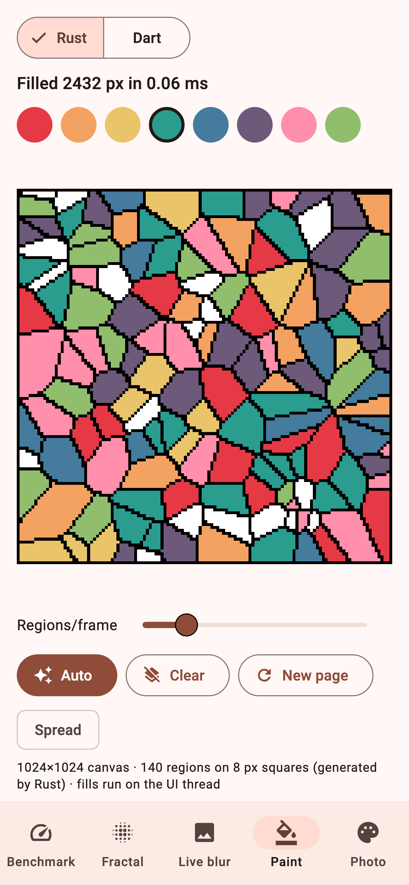
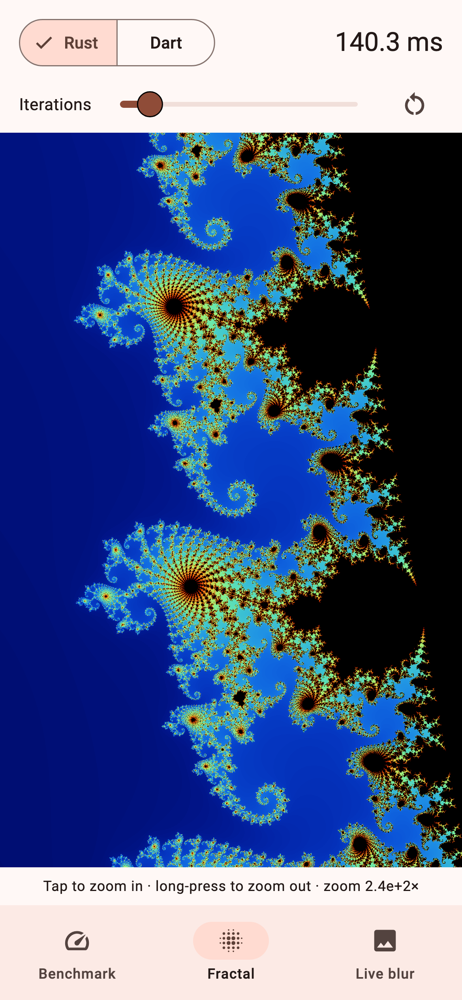
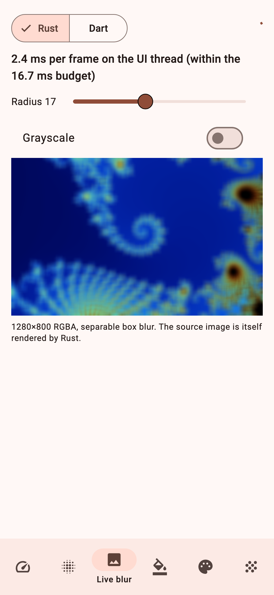

# fast_rust: Rust-speed image processing for Flutter and Dart

[](https://pub.dev/packages/fast_rust)
[](https://pub.dev/packages/fast_rust)
[](https://github.com/winterzxzz/flutter_rust/blob/main/LICENSE)
[](https://github.com/winterzxzz/flutter_rust)


**fast_rust** moves CPU-heavy pixel and data work from Dart into Rust and
calls it through `dart:ffi` `@Native` functions. Rust reads and writes your
`Uint8List` in place, so nothing is copied or serialized. A build hook
(*native assets*) runs `cargo` for you on `flutter run`, `flutter build` and
`flutter test`. There is no codegen and no Gradle, CMake or Podspec to edit.

It is built for apps that edit pixels: **recolor regions of a real photo**
while keeping its texture, **flood-fill** a coloring book, animate a fill that
**spreads out from the finger**, and **blur** images in real time. It also
covers SHA-256, sorting and number crunching. Every Rust kernel has a pure-Dart
twin (`DartReference`), and the tests check that both give identical output
(sorting differs only in where NaN goes).

- [Demo](#demo)
- [Features](#features)
- [Installation](#installation)
- [Quick start](#quick-start)
- [Recolor a photo](#recolor-a-photo)
- [Spreading fill](#spreading-fill-paint-that-flows)
- [Coloring book flood fill](#coloring-book-flood-fill)
- [Other kernels](#other-kernels)
- [Sync or async](#sync-or-async)
- [Benchmarks](#benchmarks)
- [FAQ](#faq)
- [Limitations](#limitations)

## Demo

<p align="center">
  
</p>

Real footage of the [demo app](https://github.com/winterzxzz/flutter_rust/tree/main/examples/fast_rust_demo),
recorded headless with `flutter test`. Full-quality video:
[demo.mp4](https://github.com/winterzxzz/flutter_rust/raw/main/docs/video/demo.mp4).

| Recolor a photo | Coloring book | Fractal explorer | Live blur |
| :---: | :---: | :---: | :---: |
|  |  |  |  |

## Features

### Pixel editing
- **`recolorRegionRgba`**: magic-wand selection plus a brightness-preserving
  tint. Tap the hair in a photo and it turns pink, with every strand still
  visible. Selection always reads the original photo, so you can recolor the
  same region again and again.
- **`spreadDistancesRgba` + `paintByDistanceRgba`**: a *spreading fill*. The
  color flows out from the tap as a round wave, follows the region's shape and
  goes around obstacles. It works for photos (tint) and line art (flat color).
- **`floodFillRgba`**: a scanline paint bucket with a per-channel tolerance.
  It fills a solid 2-megapixel region in about 3 ms; a few-thousand-pixel
  region takes about 0.1 ms, fast enough to fill on every `onPanUpdate`.
- **`coloringPageRgba`**: generates pixel-art coloring pages (Voronoi regions,
  black outlines) from a seed.

### Image processing
- **`boxBlurRgba`**: multi-threaded box blur, O(pixels) for any radius.
- **`grayscaleRgba`**: BT.601 grayscale, alpha kept.
- **`mandelbrotRgba`**: multi-threaded fractal renderer.

### Data
- **`sha256`**, **`sortFloat64`** (IEEE-754 total order), **`countPrimes`**,
  **`dot`**.

### Engineering
- Zero-copy **leaf** calls on your buffers (about 1.5 ns per call), plus
  **`...Async`** variants that run on a background isolate and block neither the
  UI nor the GC.
- Real multi-threading with a load-balancing work queue (Mandelbrot: 7.3×
  faster on an Apple M4).
- The Rust crate has **zero dependencies** and builds offline.
- 59 tests across Rust, Dart and Flutter. Rust output matches `DartReference`
  bit for bit (except NaN placement when sorting), and SHA-256 matches
  `package:crypto`.

## Installation

```sh
flutter pub add fast_rust     # or: dart pub add fast_rust
```

The build hook compiles the bundled Rust crate on your machine, so you need:

1. **Rust ≥ 1.88** from [rustup.rs](https://rustup.rs). `cargo` must be on
   `PATH`; the hook also looks in `~/.cargo/bin`.
2. The **Rust targets** for the platforms you build:

   ```sh
   rustup target add aarch64-linux-android armv7-linux-androideabi x86_64-linux-android   # Android
   rustup target add aarch64-apple-ios aarch64-apple-ios-sim x86_64-apple-ios             # iOS
   rustup target add aarch64-apple-darwin x86_64-apple-darwin                             # macOS
   ```

3. Android also needs the NDK installed through Android Studio.

The first build compiles Rust, which takes a few seconds. Later builds are
incremental. The package needs Dart 3.10 or newer (Flutter 3.38 or newer).

## Quick start

```dart
import 'package:fast_rust/fast_rust.dart';

// Hash 8 MiB in one zero-copy call.
final digest = FastRust.sha256(bytes);

// Blur an RGBA8888 image in place on every CPU core.
FastRust.boxBlurRgba(pixels, width: w, height: h, radius: 8);

// Paint bucket: returns the number of painted pixels.
FastRust.floodFillRgba(page, width: w, height: h, x: 10, y: 20, color: 0x2A9D8FFF);

// Heavy work off the UI isolate.
final fractal = await FastRust.mandelbrotRgbaAsync(width: 800, height: 600, scale: 3 / 800);
```

Colors are `0xRRGGBBAA`. Images are RGBA8888 `Uint8List`s of length
`width × height × 4`.

## Recolor a photo

Decode the photo into RGBA bytes once, keep that buffer untouched, and paint
into a copy:

```dart
import 'dart:ui' as ui;
import 'package:fast_rust/fast_rust.dart';
import 'package:flutter/services.dart';

final codec = await ui.instantiateImageCodec(
  (await rootBundle.load('assets/photo.jpg')).buffer.asUint8List(),
);
final image = (await codec.getNextFrame()).image;
final source = (await image.toByteData(format: ui.ImageByteFormat.rawRgba))!
    .buffer
    .asUint8List();
final canvas = Uint8List.fromList(source);

// In onTapDown: convert the tap to pixel coordinates, then
final painted = FastRust.recolorRegionRgba(
  source,             // read only: every tap selects against the original
  canvas,             // receives the tinted pixels
  width: image.width,
  height: image.height,
  x: px,
  y: py,
  color: 0xFF4D8DFF,  // pink
  tolerance: 28,      // 0..255 per channel; higher selects more
  strength: 230,      // 0..255; how strongly to tint
);

// Show it: ui.decodeImageFromPixels(canvas, w, h, ui.PixelFormat.rgba8888, ...)
```

How it works:

1. **Select.** A scanline flood fill over `source` takes every 4-connected
   pixel whose RGB is within `tolerance` of the tapped pixel.
2. **Tint.** Each selected pixel keeps its own luminance. Dark pixels map
   toward black, mid tones to the new color, and highlights toward white, so
   texture survives.

Integer math only, so `DartReference.recolorRegionRgba` gives the same bytes.

## Spreading fill ("paint that flows")

Instead of recoloring a region all at once, compute each pixel's distance from
the tap once, then paint one more ring every frame:

```dart
final dist = Uint32List(width * height);
final maxDist = FastRust.spreadDistancesRgba(
  source, dist, width: width, height: height, x: px, y: py, tolerance: 28,
);
var painted = 0;

// In a Ticker callback, with `elapsed` since the tap:
final radius = (elapsed.inMicroseconds / 1e6 * 450 * FastRust.spreadStep).round() + 1;
FastRust.paintByDistanceRgba(
  source, canvas, dist,
  width: width, height: height,
  from: painted,             // the previous radius: no pixel is painted twice
  to: radius,
  color: 0xFF4D8DFF,
  tint: true,                // false = flat color, for line art
);
painted = radius;            // stop once painted > maxDist
```

Distances are **geodesic**: they are measured along the region, so the color
flows around obstacles instead of jumping over them. They use Dijkstra with a
bucket queue and 5/7 chamfer steps for orthogonal/diagonal moves, which makes
the wave round rather than diamond-shaped. A diagonal step is only taken next
to an orthogonal one, so the color never leaks through a one-pixel diagonal gap
in an outline. The pass is O(pixels). Pixels outside the region get
`FastRust.unreached`.

## Coloring book flood fill

```dart
final page = FastRust.coloringPageRgba(width: 1024, height: 1024, cells: 140, block: 8, seed: 1);
final n = FastRust.floodFillRgba(page,
    width: 1024, height: 1024, x: tapX, y: tapY, color: 0xE63946FF);
```

`floodFillRgba` works on any RGBA image, including your own line art. With
`tolerance: 0`, filling a region with its own color is a no-op that returns 0.
For anti-aliased line art, use a small tolerance (about 32–64) so the soft edges
are filled too.

## Other kernels

| Function | Kind | What it does |
|---|---|---|
| `sha256(bytes)` / `sha256Async` | leaf / isolate | 32-byte SHA-256 digest. |
| `grayscaleRgba(rgba)` | leaf, in place | BT.601 grayscale. |
| `boxBlurRgba(...)` / `boxBlurRgbaAsync` | leaf, multi-threaded / isolate | Box blur, any radius up to `maxBlurRadius`. |
| `mandelbrotRgba(...)` / `mandelbrotRgbaAsync` | non-leaf, multi-threaded / isolate | Fractal renderer. |
| `sortFloat64(list)` / `sortFloat64Async` | leaf, in place / isolate | pdqsort with IEEE-754 total order (NaN sorted by sign). |
| `countPrimes(limit)` | non-leaf | Odd-only sieve up to `maxPrimeLimit`. |
| `dot(a, b)` | leaf | Dot product of two `Float64List`s. |
| `threadCount`, `setThreadLimit(n)` | | Read or cap Rust worker threads. |

Invalid Dart arguments throw `ArgumentError` or `RangeError` before Rust is
called. Native errors throw `FastRustException`.

## Sync or async

- **Sync methods** are *leaf* calls on your own buffers. They are the fastest,
  but they block the calling isolate and pause GC while they run. Use them for
  work of a few milliseconds, such as a tap fill or a per-frame blur.
- **`...Async` methods** copy the input to native memory, run a *non-leaf*
  call on a background isolate, and return a new list. Use them for anything
  longer.

## Benchmarks

AOT (`dart build cli`), median of 9 runs, Apple M4 with 10 threads.

| Task | Dart | Rust 1 thread | Rust 10 threads |
|---|---:|---:|---:|
| Sort 1M `double`s (vs `List.sort`) | 257 ms | 12.1 ms (21×) | 12.1 ms (21×) |
| Box blur 1920×1080, r=12 | 21.8 ms | 11.3 ms (1.9×) | 2.6 ms (8.2×) |
| Mandelbrot 800×600, 500 iterations | 127 ms | 106 ms (1.2×) | 17.5 ms (7.3×) |
| Grayscale 1920×1080 | 2.3 ms | 0.9 ms (2.6×) | 0.3 ms (7.2×) |
| Flood fill of a 1920×1080 region | 11.7 ms | 2.9 ms (4.0×) | 2.9 ms (4.0×) |
| SHA-256 of 8 MiB (vs `package:crypto`) | 34.8 ms | 18.6 ms (1.9×) | 18.7 ms (1.9×) |

The newer pixel kernels were measured on a different machine (Apple M1 Pro,
8 threads, under background load), so compare them only with each other:

| Task (1920×1080, one region) | Dart | Rust |
|---|---:|---:|
| Photo recolor (`recolorRegionRgba`) | 52.9 ms | 27.0 ms (2.0×) |
| Spreading-fill distances (`spreadDistancesRgba`) | 182.7 ms | 54.3 ms (3.4×) |

On a real photo, a tapped region is usually far smaller than the whole frame.
In the demo app, one tap on 505×607 px takes 0.05–1.3 ms. Phones are slower than
desktops; run the demo with `--profile` on your device to see real numbers. The
full table, methodology and charts are in the
[repository README](https://github.com/winterzxzz/flutter_rust#1-benchmark-results).

## FAQ

**How do I call Rust from Flutter without `flutter_rust_bridge`?**
Compile Rust to a `cdylib` that exports `extern "C"` functions, declare them
with `@Native` in Dart, and register the library from a build hook. This
package does exactly that; read `hook/build.dart` and `lib/src/bindings.dart`.

**How is this different from platform channels?**
Platform channels serialize messages through Kotlin or Swift and cost
microseconds to milliseconds per call. FFI calls are direct and synchronous, at
about 1.5 ns, and they work on your buffers without copying.

**Can I use camera frames or picked images?**
Yes. Anything you can turn into an RGBA8888 `Uint8List` works, for example
`ui.Image.toByteData(format: ui.ImageByteFormat.rawRgba)`.

**Is Rust always faster than Dart?**
No. AOT Dart is close to Rust for a simple floating-point loop on one core. The
large wins come from multi-threading, from avoiding closure-heavy Dart
patterns (sorting), and from vectorized pixel loops.

**Does it work on the web?**
No. `dart:ffi` is not available on the web.

## Limitations

- Building needs a local Rust toolchain. Prebuilt binaries are not shipped yet.
- Tested end to end on macOS arm64 (`cargo test`, `dart test`, `flutter
  test`). The Android, iOS, Linux and Windows build paths (target triples, NDK
  linker, deployment targets) are written and reviewed, but app builds on those
  platforms have not been run yet.
- Photo selection compares colors with the tapped pixel. Regions whose color
  is close to a neighbor's, such as blonde hair next to skin, can leak; lower
  `tolerance` or tap several times with a smaller one.
- Each parallel call starts fresh threads; there is no persistent pool yet.
  That costs a few tens of microseconds per call.
- Sync leaf calls pause GC while they run. Keep them short or use `...Async`.

## Example

- [`example/fast_rust_example.dart`](https://github.com/winterzxzz/flutter_rust/blob/main/packages/fast_rust/example/fast_rust_example.dart):
  a command-line tour that runs each kernel in Rust and in Dart and checks that
  the outputs match. Run it with `dart run example/fast_rust_example.dart`.
- [`examples/fast_rust_demo`](https://github.com/winterzxzz/flutter_rust/tree/main/examples/fast_rust_demo):
  a Flutter app with five tabs (Benchmark, Fractal, Live blur, Paint, Photo)
  and a Rust/Dart switch on each.

## License

MIT. See [LICENSE](https://github.com/winterzxzz/flutter_rust/blob/main/LICENSE).
